<picture>
  <source media="(prefers-color-scheme: dark)" srcset="assets/dark.svg">
  <source media="(prefers-color-scheme: light)" srcset="assets/light.svg">
  
</picture>

  
  
  

## 👋 About me

- 🎓 **BS Computer Science**, Sir Syed University of Engineering & Technology, Karachi (2026, CGPA 3.56)
- 🤖 **AI/ML engineer**: I build RAG pipelines, LLM-powered apps, agentic AI and deep learning models end to end in Python.
- 🛠️ I also build **full-stack web & mobile apps and n8n automations**, as a two-person team with Hyder Hassan.
- 📚 **Currently:** a 250-hour AI Engineering programme. Modules 1–4 (Python & software engineering, data analysis, machine learning, deep learning) are done, and I'm working on *The Handwriting Lab*: a digit reader for my own handwriting, built with classical ML, a neural network from scratch in NumPy, PyTorch and a CNN.
- 🔜 **Next up:** Azure AI (AI-901), GenAI & LLM engineering, advanced RAG, agentic AI with LangGraph & MCP, FastAPI backends, MLOps and cloud deployment.
- 📫 **Reach me:** projectpartner0317@gmail.com

### 🚀 Featured projects

| Project | What it does | Stack |
|---|---|---|
| [**VirtuProf**](https://github.com/Saadjunaid0317/VirtuProf) | Final-year project: turns uploaded PDFs into interactive voice lectures, with RAG so answers stay grounded in the source | FastAPI, React, OpenAI, FAISS, WebSockets, Redis, Celery, Piper TTS |
| [**ServisLink**](https://github.com/Saadjunaid0317/servislink) | Google Antigravity Hackathon: agentic AI that books plumbers, electricians and painters through chat | Python, LLMs, agentic architecture |
| [**German → English Translator**](https://github.com/Saadjunaid0317/German-English-Translator) | Neural machine translation trained from scratch, with a live demo | TensorFlow, GRU, Bahdanau attention, Streamlit |
| [**Gangsheet Builder**](https://github.com/Saadjunaid0317/gangsheet-builder) | Print-industry web app: image layout, cutlines, PDF/PNG export | React (Vite), FastAPI, Python imaging |

## 🧰 Tech stack

**Languages** 

**AI, ML & Data** 

**Backend & APIs** 

**Frontend & Mobile** 

**Databases** 

**Automation & E-commerce** 

**Tools** 

**Currently learning** 🌱 

## 📊 GitHub activity

<picture>
  <source media="(prefers-color-scheme: dark)" srcset="https://raw.githubusercontent.com/Saadjunaid0317/Saadjunaid0317/output/stats-dark.svg">
  <source media="(prefers-color-scheme: light)" srcset="https://raw.githubusercontent.com/Saadjunaid0317/Saadjunaid0317/output/stats-light.svg">
  
</picture>

<picture>
  <source media="(prefers-color-scheme: dark)" srcset="https://raw.githubusercontent.com/Saadjunaid0317/Saadjunaid0317/output/github-snake-dark.svg">
  <source media="(prefers-color-scheme: light)" srcset="https://raw.githubusercontent.com/Saadjunaid0317/Saadjunaid0317/output/github-snake.svg">
  
</picture>

Activity cards and the snake are rebuilt every day by a GitHub Action in this repo.
